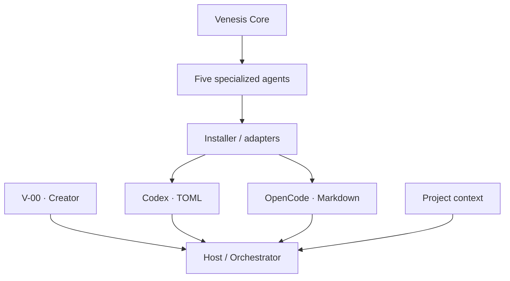

<div align="center">

# VENESIS

**One origin. Multiple minds.**

A collective of specialized AI agents for software engineering and creative direction.


[Visão geral](#visão-geral) · [Agentes](#generation-01) · [Instalação](#instalação) · [Arquitetura](#arquitetura)

</div>

## Visão geral

Venesis é um ecossistema reutilizável de agentes de IA especializados, criado por [vsantus](https://github.com/vsantus). Seu nome combina a identidade do criador com a ideia de gênese: uma origem, múltiplas inteligências e especialidades complementares.

O projeto transforma a experiência de um time multidisciplinar em definições portáveis, com personalidade, competências, limites operacionais e protocolos compartilhados. A origem técnica está nos agentes do Maranata System; o Venesis é independente de produto e stack.

- **Especialização:** cinco agentes com responsabilidades e critérios de entrega definidos.
- **Portabilidade:** uma fonte de instruções, adaptadores para Codex e OpenCode.
- **Contexto:** cada projeto mantém suas regras, arquitetura e ferramentas.
- **Colaboração:** handoffs e revisão transversal, quando a plataforma suporta delegação.
- **Controle:** ações externas e sensíveis dependem de autorização; validações devem ser verificáveis.

## Generation 01

| ID | Agente | Especialidade | Inspiração |
|---|---|---|---|
| V-01 | [Berners](agents/berners/instructions.md) | Front-end Engineering | Tim Berners-Lee |
| V-02 | [Turing](agents/turing/instructions.md) | Back-end Engineering | Alan Turing |
| V-03 | [Uncle Bob](agents/uncle-bob/instructions.md) | QA & Software Quality | Robert C. Martin |
| V-04 | [Codd](agents/codd/instructions.md) | Data Engineering | Edgar Frank Codd |
| V-05 | [Rams](agents/rams/instructions.md) | Design & Creative Direction | Dieter Rams |

**Berners** — interfaces, arquitetura frontend, acessibilidade, performance e design systems.

**Turing** — APIs, domínio, integrações, autorização, arquitetura e resiliência.

**Uncle Bob** — testes, code review, SOLID, TDD, regressões e qualidade baseada em risco.

**Codd** — modelagem, persistência, migrations, transações, consultas e pipelines de dados.

**Rams** — UX/UI, branding, direção de arte, criativos e esteiras de conteúdo social.

## Arquitetura



As fontes em `agents/`, `core/` e `skills/` são compiladas pelo instalador em instruções autocontidas. Não é necessário manter duas versões de cada persona. O host é responsável pela execução e pela delegação; o Venesis não é um runtime próprio.

```text
venesis/
├── agents/          # Identidade e especificações dos cinco agentes
├── core/            # Princípios e colaboração
├── skills/          # Competências complementares
├── integrations/    # Documentação por plataforma
├── scripts/         # Instalador e geração de configurações
├── templates/       # Contexto de projeto e briefing criativo
├── AGENTS.md
├── CHANGELOG.md
└── README.md
```

## Instalação

Pré-requisitos: Git, Python 3.11+ e uma versão do Codex ou OpenCode compatível com agentes personalizados.

```bash
git clone https://github.com/vsantus/venesis.git
cd venesis
python scripts/install.py /caminho/do/projeto --target all --dry-run
python scripts/install.py /caminho/do/projeto --target all
```

No Windows, use `py -3` se necessário. O caminho do projeto deve existir.

| Plataforma | Target | Destino |
|---|---|---|
| [Codex](integrations/codex/README.md) | `codex` | `.codex/agents/*.toml` |
| [OpenCode](integrations/opencode/README.md) | `opencode` | `.opencode/agents/*.md` |
| Ambas | `all` | Ambos os diretórios |

Instale somente os especialistas necessários:

```bash
python scripts/install.py /caminho/do/projeto --target opencode --agents berners rams
```

O instalador preserva arquivos existentes por padrão. Use `--force` apenas após revisar conflitos. Nenhum modelo, credencial, permissão ou configuração global é alterado. Reinicie a sessão do host e verifique a descoberta dos agentes.

## Exemplos de uso

```text
Berners: implemente a tela conforme o design system existente.
Turing: revise o contrato da API e os casos de autorização.
Codd: avalie a migration e os riscos de integridade.
Uncle Bob: revise o diff e execute os testes permitidos.
Rams: produza um carrossel de Instagram conforme o briefing da marca.
```

A sintaxe de invocação e a disponibilidade de ferramentas dependem do host.

### Fluxo de desenvolvimento

Rams especifica a experiência, Berners implementa a interface, Turing define serviços e contratos, Codd valida a persistência e Uncle Bob revisa a qualidade. O fluxo pode variar por tarefa e depende da capacidade de delegação do host.

### Fluxo criativo

Briefing → direção de arte → produção → revisão visual → aprovação → entrega para publicação. Rams pode produzir ativos com ferramentas disponíveis, sem publicar automaticamente. Consulte [a skill criativa](skills/rams-creative.md).

### Onde Rams salva os criativos

Por padrão, no **projeto consumidor**, em `creatives/instagram/AAAA/MM/campaign-slug/` (o canal varia conforme o briefing). O agente cria pastas sob demanda:

```text
campaign-slug/
├── briefing.md
├── drafts/       # Artes geradas, versionadas
├── sources/      # Fontes editáveis, quando disponíveis
├── approved/     # Cópias aprovadas explicitamente
├── caption.md
└── manifest.json
```

Para personalizar, copie [templates/venesis.config.json](templates/venesis.config.json) para a raiz do projeto consumidor como `venesis.config.json`. Sem configuração, os padrões acima se aplicam. A configuração é interpretada pelo Rams durante a execução; o instalador não cria pastas de artes nem fornece um motor de renderização. A produção depende das ferramentas e permissões do host.

**Teste:** solicite ao Rams um post para Instagram, com arte real salva em drafts/, fonte editável quando disponível, legenda e manifest. Peça os caminhos dos arquivos e revise antes de aprovar.

Se já instalou o Rams, atualize o clone e regenere apenas esse agente (revise o arquivo local antes de usar --force):

```bash
git pull
python scripts/install.py /caminho/do/projeto --target all --agents rams --force
```

## Status e roadmap

Versão de desenvolvimento **0.1.0**. As configurações e o instalador existem; a compatibilidade em execução e os resultados dos agentes ainda precisam ser validados.

- [x] Generation 01 e especificações individuais
- [x] Núcleo compartilhado e adaptadores Codex/OpenCode
- [x] Workflow criativo de Rams
- [ ] Testes automatizados do instalador e smoke tests nos hosts
- [ ] Avaliações de comportamento em projetos reais
- [ ] Release estável e política de versionamento

## Contribuição e direitos

Sugestões e issues são bem-vindas. Preserve as cinco especialidades fundadoras, mantenha instruções independentes de stack e documente mudanças de comportamento. A licença de distribuição ainda será definida pelo mantenedor.

Os nomes são homenagens a referências históricas; o projeto não representa essas pessoas nem possui afiliação com elas ou com os fornecedores das plataformas.

---

<div align="center">

**VENESIS · Generation 01**  
Created by [vsantus](https://github.com/vsantus)

</div>
